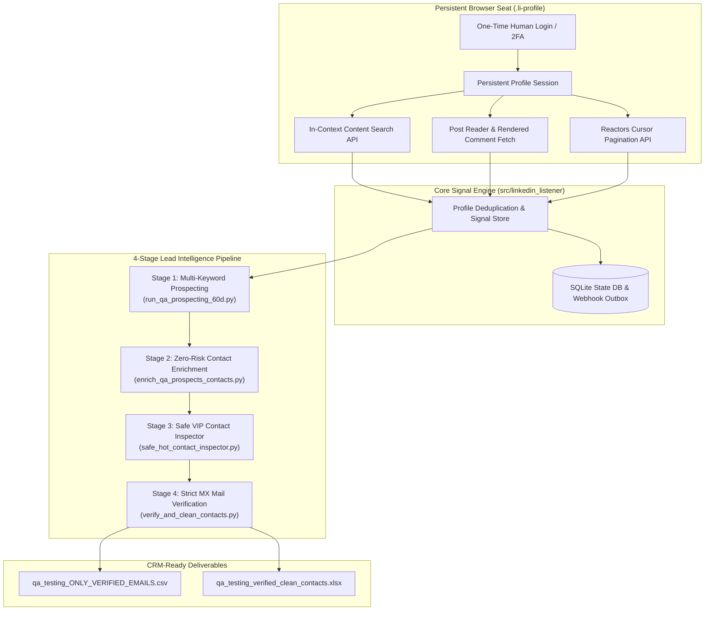

# InSignal-B2B-Prospector

**Real-Time LinkedIn Keyword Signal Tracker, Decision-Maker Scoring & DNS MX Verified Contact Intelligence Engine**

[](https://www.python.org/)
[](https://playwright.dev/)
[](https://github.com/yifeikong/curl_cffi)
[](https://www.dnspython.org/)

An enterprise-grade, anti-ban LinkedIn signal monitoring, post discovery, and lead intelligence system. 

It monitors high-intent industry keywords and hashtags, discovers active posts within custom recency windows, captures authors, commenters, and reactors, and enriches top decision-makers with **strictly verified corporate emails backed by live DNS MX mail servers**.

---

## 📺 Video Walkthrough & Project Demo

> 📹 **Watch the in-depth architecture walkthrough, live pipeline demonstration, and DNS MX verification demo:**
>
> [](YOUR_VIDEO_LINK_HERE)
>
> *(Click the badge above to watch the full video walkthrough, code demonstration, and output review)*

---

## 📑 Table of Contents

- [Video Walkthrough & Demo](#-video-walkthrough--project-demo)
- [Overview & Architecture](#-overview--architecture)
- [How It Solved Real Problems: Evolutionary Journey](#-how-it-solved-real-problems-evolutionary-journey)
- [Key Features](#-key-features)
- [Project Directory Organization](#-project-directory-organization)
- [Clean-Up & Non-Essential Files Guide](#-clean-up--non-essential-files-guide)
- [Installation & Setup](#-installation--setup)
- [Usage Guide](#-usage-guide)
  - [1. Authentication & Session Check](#1-authentication--session-check)
  - [2. Ad-hoc CLI Listening](#2-ad-hoc-cli-listening)
  - [3. Scheduled First-Seen Post Signals](#3-scheduled-first-seen-post-signals)
  - [4. The 4-Stage Lead Generation & Verification Pipeline](#4-the-4-stage-lead-generation--verification-pipeline)
- [Verification Engine & Anti-Hallucination Philosophy](#-verification-engine--anti-hallucination-philosophy)
- [Output Data Dictionary](#-output-data-dictionary)
- [Safety & Anti-Ban Architecture](#-safety--anti-ban-architecture)
- [Security, Privacy & Ethics](#-security-privacy--ethics)

---

## 🔭 Overview & Architecture

Unlike traditional scrapers that rely on fragile DOM selectors or high-risk third-party APIs, this system utilizes **Persistent In-Seat Browser Context Execution**:

1. **Persistent Real-Browser Profile (`.li-profile`)**: Operates inside your actual Chrome browser profile with stored cookies, session tokens, and human fingerprinting.
2. **Reverse-Engineered In-Context Transport**: Replays LinkedIn's internal `com.linkedin.sdui.search.contentSearchResults` and `reactorsListByTypeScreen` endpoints directly within authenticated browser memory.
3. **Multi-Stage Enrichment**: Augments raw engagement data with off-platform lexical parsing, DNS MX mail server lookups, and capped VIP profile inspections.



---

## 🛠️ How It Solved Real Problems: Evolutionary Journey

This codebase evolved through five distinct problem-solving phases during active production deployment:

### Phase 1: Overcoming Fragile Scraping & Session Bans
* **Problem**: Traditional headless scraping tools get blocked within minutes due to bot detection, missing 2FA, and changing DOM selectors.
* **Solution**: Developed a persistent seat model (`session.py`) utilizing real Google Chrome profiles (`.li-profile`). Added in-browser request replay (`rsc.py`) to call LinkedIn's internal content search endpoints directly using authenticated CSRF tokens and cookies.

### Phase 2: Eliminating Rate Limits & Manual Keyword Fatigue
* **Problem**: Manually running searches across multiple keywords was slow and risked account bans when requests were triggered too quickly.
* **Solution**: Built [`run_qa_prospecting_60d.py`](file:///d:/linkedin-keyword-signal-monitor_test_3/run_qa_prospecting_60d.py), orchestrating 12 high-intent search queries with automated 20.0-second anti-ban throttling, recency filtering, cross-keyword profile deduplication, and decision-maker scoring (25–100 score).

### Phase 3: Extracting Contact Info Without Account Risk
* **Problem**: Sales campaigns require direct emails and phone numbers, but visiting hundreds of profiles on LinkedIn triggers commercial use limits and security checkpoints.
* **Solution**: Created [`enrich_qa_prospects_contacts.py`](file:///d:/linkedin-keyword-signal-monitor_test_3/enrich_qa_prospects_contacts.py). This zero-risk layer runs 100% off-platform using regex extraction on bios/headlines, company domain inference, and B2B corporate email permutations (`first.last@company.com`) without a single network call to LinkedIn.

### Phase 4: Surgical VIP Contact Extraction
* **Problem**: C-level executives and VPs often keep contact details in their private LinkedIn "Contact Info" modal, unreadable by off-platform algorithms.
* **Solution**: Built [`safe_hot_contact_inspector.py`](file:///d:/linkedin-keyword-signal-monitor_test_3/safe_hot_contact_inspector.py). It inspects *only* the top-scored decision-makers with a strict daily cap (20–25 profiles maximum), natural human jitter delays (35.0s–55.0s), and automated extraction from `/overlay/contact-info/`.

### Phase 5: Eliminating Domain Hallucinations via DNS MX Verification
* **Problem**: Inferred domain logic occasionally generated "hallucinated domains" from job titles (e.g., turning "QA Manager" into `qamanager.com`). Inferred domains also lacked proof of active mail servers.
* **Solution**: Engineered [`verify_and_clean_contacts.py`](file:///d:/linkedin-keyword-signal-monitor_test_3/verify_and_clean_contacts.py). It incorporates a 50+ item role/buzzword blacklist, verified enterprise domain mappings, and **live DNS MX record validation** via `dnspython`. It enforces a strict zero-tolerance policy: unverified emails are marked as `NO_RELIABLE_EMAIL` rather than producing false data.

---

## ✨ Key Features

- **In-Seat Browser Replay**: Replays LinkedIn's content-search GraphQL/SDUI protocols with authentic headers and cookies.
- **Full Engagement Extraction**: Collects post authors, visible commenters (`fetchComment`), and paginated reactors (`reactorsListByTypeScreen`).
- **Profile-Level Deduplication**: Merges individuals across multiple posts, tracking their engagement types (`posted`, `commented`, `reacted`) and source links.
- **Repeatable First-Seen Signals**: Configurable watches stored in SQLite with idempotent event IDs, JSONL snapshots, and webhook delivery.
- **Decision-Maker Scoring**: Heuristic scoring engine evaluating organizational seniority (VP, Director, Head, Lead) and buying intent ("hiring", "evaluating", "tooling").
- **Zero-Hallucination Email Verification**: Every exported email is verified against public DNS MX records to guarantee real mail-server deliverability.
- **Anti-Ban Safety Controls**: Configurable delays, human jitter pacing, and daily inspection caps.

---

## 📂 Project Directory Organization

### Recommended Production Layout

For a clean and professional GitHub repository, organize your files as follows:

```
InSignal-B2B-Prospector/
├── .gitignore                      # Configured to exclude profiles, credentials & outputs
├── README.md                       # Comprehensive documentation
├── pyproject.toml                  # Package dependencies & CLI entrypoints
│
├── src/                            # Core Reusable Library & CLI
│   └── linkedin_listener/
│       ├── __init__.py
│       ├── cli.py                  # Primary CLI (listen, search, inspect)
│       ├── engagement.py           # Comment & reaction pagination handlers
│       ├── export.py               # Profile deduplication & CSV export
│       ├── reader.py               # Post permalink & content parser
│       ├── rsc.py                  # Reverse-engineered LinkedIn search protocol
│       ├── session.py              # Playwright persistent Chrome wrapper
│       ├── signal.py               # Watch scheduler, SQLite state & webhooks
│       ├── ssr.py                  # Server-side rendering fallback parser
│       └── data/                   # Default search action payloads
│
├── pipelines/                      # Operational Workflows & Lead Pipelines
│   ├── run_qa_prospecting_60d.py   # Multi-keyword signal collector & scorer
│   ├── enrich_qa_prospects_contacts.py # Zero-risk off-platform contact discovery
│   ├── safe_hot_contact_inspector.py   # Surgical VIP contact-info overlay inspector
│   └── verify_and_clean_contacts.py    # Strict lexical blacklist & DNS MX verifier
│
├── config/                         # Configuration Templates
│   └── signal.example.json         # Example watch monitor configuration
│
├── tests/                          # Offline Unit & Integration Tests
│   ├── fixtures/                   # Sanitized mock payloads
│   ├── test_cli.py
│   ├── test_engagement.py
│   ├── test_export.py
│   ├── test_reader.py
│   ├── test_rsc.py
│   └── test_signal.py
│
└── output/                         # Generated Exports (Ignored by Git)
    └── .gitkeep
```

---

## 🧹 Clean-Up & Non-Essential Files Guide

When preparing this repository for a professional public or private GitHub upload, **do not commit the following files**:

| File / Directory | Why It Must Be Excluded | Action Required |
|---|---|---|
| **`.li-profile/`** | **CRITICAL SECURITY RISK.** Contains live Chrome cookies, session storage, and login credentials. Committing this allows anyone to access your LinkedIn account. | Kept in `.gitignore`. **Never commit.** |
| **`Other_2/`** | Contains old backup ZIP archives (`test_0.zip`, `test_1.zip`) totaling **264+ MB**. Exceeds GitHub's 100MB file limit and causes push errors. Also contains local agent chat logs. | Excluded in `.gitignore` or deleted. |
| **`qa people.csv`<br>`qa_verified_checklist.csv`<br>`*.xlsx`** | Raw prospect datasets containing personal names, headlines, and contact details (PII). Violates data privacy standards if exposed on public Git repositories. | Add to `output/` and keep in `.gitignore`. |
| **`__pycache__/`<br>`*.egg-info/`** | Python bytecode and local installation artifacts. | Keep in `.gitignore`. |
| **`.venv/`** | Virtual environment containing local binary files. | Keep in `.gitignore`. |

> [!IMPORTANT]
> The updated [`.gitignore`](file:///.gitignore) has been pre-configured with rules for `*.xlsx`, `*.zip`, `Other_2/`, and `*.li-profile/` to ensure no sensitive files or oversized archives are pushed to GitHub.

---

## 🚀 Installation & Setup

### Prerequisites

- Python 3.11+
- Google Chrome installed on your machine

### 1. Clone & Set Up Virtual Environment

```bash
git clone https://github.com/Jigneshxi/InSignal-B2B-Prospector.git
cd InSignal-B2B-Prospector

python -m venv .venv
# Windows:
.\.venv\Scripts\activate
# Linux/macOS:
source .venv/bin/activate
```

### 2. Install Dependencies

```bash
# Install core package in editable mode
pip install -e .

# Install pipeline dependencies (DNS verification and Excel support)
pip install dnspython openpyxl

# Install Playwright browser binaries
playwright install chromium
```

---

## 💻 Usage Guide

### 1. Authentication & Session Check

Run the login command once. A real Chrome window will open:

```bash
linkedin-listener --login
```

Sign in to LinkedIn with your standard credentials and complete 2FA. The session is saved to `.li-profile/` and reused across all subsequent runs.

Verify your session status at any time:

```bash
python -m linkedin_listener.cli --check
# Expected: session status: 200
```

---

### 2. Ad-hoc CLI Listening

Search for keyword or hashtag signals directly from the terminal:

```bash
# Listen to a keyword within the last 7 days and export to CSV
linkedin-listener listen "Quality Engineering" --max-age-days 7 --out leads.csv

# Inspect a single post permalink for full comments and reactors
linkedin-listener "https://www.linkedin.com/feed/update/urn:li:activity:7180000000000000000/" --out post_details.csv
```

**Common Flags:**
- `--max-age-days <n>`: Exact post age cutoff (defaults to 7).
- `--max-posts <n>`: Maximum number of posts to process.
- `--max-reactor-pages <n>`: Cursors to follow for post reactions (default 0 follows all).
- `--request-delay <sec>`: Pause between internal endpoint calls (recommended: 15–20s for safety).
- `--headless`: Run Chrome in background headless mode.

---

### 3. Scheduled First-Seen Post Signals

For recurring cron or Task Scheduler jobs, use the Signal Monitor:

```bash
linkedin-signal-monitor --config config/signal.example.json --state-db signals.sqlite3
```

- Remembers seen post URNs in a local SQLite database.
- Emits events *only* when an unseen post is discovered.
- Automatically exports to JSONL and sends payloads to `LINKEDIN_SIGNAL_WEBHOOK_URL` if configured.

---

### 4. The 4-Stage Lead Generation & Verification Pipeline

To run the complete high-intent lead generation workflow:

```bash
# Stage 1: Batch Search, Anti-Ban Throttling & Decision-Maker Scoring
python run_qa_prospecting_60d.py

# Stage 2: Zero-Risk Off-Platform Contact & Domain Enrichment
python enrich_qa_prospects_contacts.py

# Stage 3: Safe VIP Contact Overlay Inspector (Capped at 20-25 HOT leads)
python safe_hot_contact_inspector.py

# Stage 4: Strict DNS MX Mail-Server Verification & Fake Domain Purge
python verify_and_clean_contacts.py
```

**Pipeline Results are saved to `output/qa_testing_60d/`:**
- `qa_testing_active_60d_prospects.csv`: Raw deduplicated and scored prospects.
- `qa_testing_enriched_contacts.csv`: Prospects with inferred domains and emails.
- `qa_testing_verified_clean_contacts.csv`: Complete dataset with verification audit status.
- `qa_testing_ONLY_VERIFIED_EMAILS.csv`: High-deliverability list with valid corporate MX records.

---

## 🛡️ Verification Engine & Anti-Hallucination Philosophy

The verification engine ([`verify_and_clean_contacts.py`](file:///d:/linkedin-keyword-signal-monitor_test_3/verify_and_clean_contacts.py)) uses a three-tier validation process to ensure data accuracy:

1. **Anti-Hallucination Lexical Blacklist**: Filters out 50+ job titles and buzzwords (e.g., `sdet`, `manual tester`, `test lead`, `freelance`, `remote`) to prevent them from being mistaken for domain names.
2. **Enterprise Domain Map**: Converts messy employer strings into canonical domains (e.g., `Tech Mahindra` $\rightarrow$ `techmahindra.com`, `EY` $\rightarrow$ `ey.com`, `Mastercard` $\rightarrow$ `mastercard.com`).
3. **Live DNS MX Verification**: Performs DNS MX queries via `dnspython` against root mail exchangers to confirm the domain is configured to receive emails.
4. **Honest Reporting**: If an email cannot be verified, it is marked as `NO_RELIABLE_EMAIL` rather than hallucinating placeholder data.

---

## 📊 Output Data Dictionary

### Core Prospect Columns

| Column | Description |
|---|---|
| `person_name` | Full name as displayed on LinkedIn (badges stripped). |
| `profile_url` | Canonical public profile URL (`https://www.linkedin.com/in/...`). |
| `headline` | Professional headline / current role. |
| `engagement_types` | Interaction types observed (`posted`, `commented`, `reacted`). |
| `reaction_types` | Types of reactions observed (e.g., `Like`, `Support`, `Insightful`). |
| `source_keywords` | Search keywords that identified the prospect. |
| `source_post_urls` | Permalink(s) to the specific post(s) where engagement occurred. |
| `lead_score` | Algorithmic priority score (25 to 100). |
| `decision_maker_tier` | Classification (`VIP Decision Maker`, `Senior Lead`, `Practitioner`). |

### Enriched & Verified Columns

| Column | Description |
|---|---|
| `company_name` | Cleaned enterprise company name. |
| `company_domain` | Canonical corporate domain. |
| `email` | Direct contact email (or `NO_RELIABLE_EMAIL`). |
| `phone` | Direct contact phone / WhatsApp if published. |
| `verification_status` | `VERIFIED_CORPORATE_MX`, `DIRECT_PROFILE_CONTACT`, or `UNVERIFIED`. |
| `mx_host` | Active mail exchange host verified via DNS (e.g., `mail.protection.outlook.com`). |

---

## ⚖️ Safety & Anti-Ban Architecture

To protect your LinkedIn account from throttling and bans, this project implements multiple safety measures:

- **Browser Context Isolation**: Avoids headless browser detection by using real Chrome profile instances.
- **Pacing & Request Throttling**: The prospecting pipeline enforces 20.0-second pauses between search queries and internal API calls.
- **Human Jitter**: The VIP inspector applies randomized 35.0s–55.0s delays between profile visits.
- **Strict Daily Quotas**: In-depth profile inspections are capped at 20–25 profiles per day.
- **Graceful Backoff**: Automatically halts execution upon encountering HTTP 429 status codes while preserving all data collected up to that point.

---

## 🔒 Security, Privacy & Ethics

- **Never Commit Credentials**: Your `.li-profile/` directory contains active login cookies. Keep it listed in `.gitignore` at all times.
- **Respect Data Privacy**: Follow all applicable privacy regulations (such as GDPR and CCPA) regarding personal data and cold outreach.
- **Terms of Service**: This tool is designed for educational, research, and authorized personal use. Users are responsible for complying with LinkedIn's Terms of Service.
